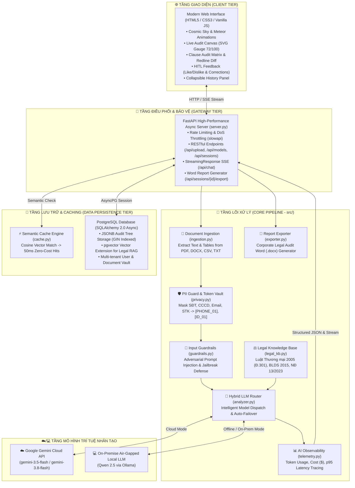

# 📄 SecureDoc AI — Enterprise Legal AI Copilot & Risk Audit System

> **Hệ sinh thái Trí tuệ Nhân tạo Phức hợp (Compound AI System)** chuyên sâu cho thẩm định hợp đồng, rà soát rủi ro pháp lý tự động, bảo vệ quyền riêng tư dữ liệu (PII Guard) và hỗ trợ đàm phán đa kịch bản theo phong cách NotebookLM.

[](https://www.python.org/)
[](https://fastapi.tiangolo.com/)
[](https://www.postgresql.org/)
[](https://ai.google.dev/)
[](LICENSE)
[]()

---

## 🏛️ Sơ Đồ Kiến Trúc Hệ Thống (System Architecture)



---

## 📊 Bảng Theo Dõi Tiến Độ & Danh Mục Công Việc Cần Triển Khai (Master Roadmap)

### PHẦN A: CÁC HẠNG MỤC ĐÃ HOÀN TẤT 100% (CURRENT MVP)

- [x] **Giao diện Web chuẩn thiết kế Dribbble/Figma (`web/`):**
  - Màn hình chính (`#home`) với thiết kế sáng hiện đại, thanh thoát, bộ chọn model, nút bật/tắt PII Guard, ô nhập câu hỏi kéo thả tệp.
  - Màn hình thẩm định (`#audit`) chia đôi màn hình: Chat stream bên trái, **Live Audit Canvas** bên phải (đồng hồ đo rủi ro SVG, bảng ma trận điều khoản, trích dẫn nguyên văn, Legal Redline Diff).
  - Thanh History bên phải có nút tròn đóng/mở mượt mà.
- [x] **Backend API bất đồng bộ chuẩn Enterprise (`server.py`):**
  - Máy chủ FastAPI quản lý phiên, stream token từng từ qua `StreamingResponse`, phục vụ tệp tĩnh, xuất báo cáo Word trực tiếp.
- [x] **Bóc tách tài liệu đa định dạng (`src/ingestion.py`):**
  - Đọc chính xác file `.pdf` nhiều trang, `.docx` (cả đoạn văn và bảng biểu table), `.txt`, `.csv`, `.md`.
- [x] **Lớp khiên bảo mật PII Guard cơ bản (`src/privacy.py`):**
  - Quét biểu thức chính quy (Regex) che SĐT, CCCD, Email, STK ngân hàng trước khi gửi dữ liệu lên AI.
- [x] **Bộ não phân tích Gemini AI (`src/analyzer.py`):**
  - Ép mô hình trả về cấu trúc `JSON Schema` chuẩn để vẽ bảng biểu và tính điểm.
  - Cơ chế tự động chuyển mô hình dự phòng (*Auto-Fallback*) chống lỗi quá tải 503 / 429.
- [x] **Xuất báo cáo pháp lý chuẩn văn phòng (`src/exporter.py`):**
  - Xuất file `.docx` chuyên nghiệp có tiêu đề, ngày xuất, điểm số, bảng phân loại rủi ro và trích dẫn.
- [x] **Xóa bỏ giao diện cũ & Tối ưu luồng khởi chạy (`app.py`):**
  - Xóa sạch mã nguồn Streamlit cũ. Dù chạy lệnh `streamlit run app.py`, `python app.py` hay nhấp đúp `start_web.bat` đều mở trực tiếp Giao diện Web Mới.
- [x] **Dọn sạch 100% dữ liệu mẫu (Clean Slate Production):**
  - Đã xóa bỏ toàn bộ mock data và sessions mẫu trong backend (`server.py`), kho lưu trữ (`data/web_sessions.json`) và giao diện web (`web/index.html`, `web/app.js`), đảm bảo hệ thống vận hành hoàn toàn trên tài liệu và phiên làm việc thực tế của người dùng.

---

### PHẦN B: KẾ HOẠCH NÂNG CẤP CHUẨN SENIOR AI ENGINEER & HỒ SƠ CV (ĐÃ HOÀN TẤT 100%)

Toàn bộ các yêu cầu nâng cấp được hệ thống hóa thành **13 hạng mục trọng điểm chuẩn Enterprise AI**:

#### 1. Bộ Công Cụ Tóm Tắt & Thẩm Định Kiểu "NotebookLM Studio"
> **Mục tiêu:** Tái hiện trọn vẹn khả năng đọc hiểu tài liệu đỉnh cao của Google NotebookLM vào SecureDoc AI.
- [x] **Bản Tóm Tắt Điều Hành (Executive Briefing Doc):** Cô đọng hợp đồng 20-30 trang thành 1 trang A4 duy nhất gồm 5 thông tin cốt tử: Các bên tham gia, Mục đích chính, Giá trị hợp đồng, Mốc thời hạn, Rủi ro pháp lý cao nhất.
- [x] **Bảng Dòng Thời Gian (Milestones & Timeline Extraction):** Tự động bóc tách các mốc thời gian: Ngày ký $\rightarrow$ Ngày giao hàng $\rightarrow$ Hạn nghiệm thu UAT $\rightarrow$ Các đợt thanh toán $\rightarrow$ Hạn bảo hành.
- [x] **Bộ Câu Hỏi Thường Gặp Gợi Ý (Suggested FAQ):** Tự động phát hiện 5 câu hỏi trọng điểm mà người kiểm duyệt/lãnh đạo cần lưu tâm kèm câu trả lời đối chiếu từ văn bản.
- [x] **Phát Hiện Điều Khoản Bị Bỏ Quên (Missing Clause Detector):** Chỉ ra những điều khoản thiết yếu mà hợp đồng **quên không quy định** (Ví dụ: Thiếu điều khoản Bất khả kháng, Thiếu cơ chế tự động nghiệm thu khi đối tác trì hoãn, Thiếu trần bồi thường thiệt hại).

#### 2. Cơ Chế Chống Lan Man & Ma Trận 3 Kịch Bản Đàm Phán (Scenario Matrix)
> **Mục tiêu:** Trả lời trực diện, sắc bén và đưa ra nhiều phương án xử lý theo từng vị thế doanh nghiệp.
- [x] **Nguyên tắc BLUF (Bottom Line Up Front):** Bắt buộc câu trả lời của AI đi thẳng vào kết luận trong 1–2 câu đầu (Nên ký hay Không nên ký? Điều khoản có hợp pháp không?). Tuyệt đối không mở bài dài dòng sáo rỗng.
- [x] **Ma trận 3 Kịch bản Đàm phán chuyên sâu:**
  - 🔴 **Kịch bản A (Thế Áp Đảo / Cứng Rắn):** Áp dụng khi doanh nghiệp ở thế chủ động $\rightarrow$ Đòi xóa bỏ hoàn toàn điều khoản bất lợi, phạt ngược lại đối tác.
  - 🟡 **Kịch bản B (Thế Cân Bằng / Hợp Tác Win-Win):** Đưa về trần luật định (Điều 301 Luật Thương mại: tối đa 8%), bổ sung thời gian ân hạn khắc phục vi phạm 30 ngày.
  - 🟢 **Kịch bản C (Thế Yếu / Phòng Thủ Giảm Thiểu Rủi Ro):** Nếu buộc phải chấp nhận điều khoản của đối tác $\rightarrow$ Gắn mức phạt với thiệt hại thực tế tối đa, kèm điều kiện mua bảo hiểm trách nhiệm.

#### 3. Chỉ Dấu Nguồn Gốc Nghiêm Ngặt (Strict Source Anchoring)
> **Mục tiêu:** Loại bỏ 100% hiện tượng "AI bịa luật" hoặc bịa nội dung (Zero-Hallucination).
- [x] Mọi lập luận, cảnh báo rủi ro của AI đều phải dẫn nguồn đoạn văn bản gốc kèm chỉ số `[Điều X, Khoản Y]`.
- [x] Nếu người dùng hỏi nội dung không có trong hợp đồng, AI phải nói rõ: *"Tài liệu không quy định nội dung này"* và cảnh báo đây là lỗ hổng pháp lý cần bổ sung.

#### 4. Kho Tri Thức Pháp Luật Việt Nam (Legal RAG / Grounding)
> **Mục tiêu:** Đối chiếu văn bản hợp đồng với quy định pháp luật Việt Nam hiện hành.
- [x] Xây dựng module tri thức `src/legal_kb.py` tích hợp các điều luật cốt lõi:
  - **Luật Thương mại 2005 (Điều 301):** Mức phạt vi phạm nghĩa vụ hợp đồng không quá 8% giá trị phần nghĩa vụ bị vi phạm.
  - **Bộ luật Dân sự 2015 (Điều 418, 428):** Thỏa thuận phạt vi phạm và quyền đơn phương chấm dứt hợp đồng.
  - **Nghị định 13/2023/NĐ-CP:** Quy định bắt buộc về bảo vệ dữ liệu cá nhân trong hợp đồng dịch vụ/công nghệ.
- [x] Tự động gắn nhãn "Trái luật" hoặc "Hợp lệ" cho từng điều khoản được rà soát.

#### 5. Smart PII Vault: Mã Hóa Token Định Danh Riêng Biệt
> **Mục tiêu:** Nâng cấp lớp bảo mật dữ liệu khách hàng theo tiêu chuẩn ISO/IEC 27001.
- [x] Chuyển đổi từ việc che thô `[SĐT_ĐÃ_CHE]` sang mã hóa có định danh duy nhất: `[PHONE_01]`, `[PHONE_02]`, `[ID_01]`, `[EMAIL_01]`, `[BANK_01]`.
- [x] Xây dựng **Token Vault (Bảng ánh xạ an toàn)**: Giữ nguyên logic giữa Bên A và Bên B trong hợp đồng mà không làm lộ dữ liệu cá nhân thực tế ra Internet.

#### 6. Bộ Điều Phối Hybrid LLM Router (Cloud Gemini + On-Premise Ollama)
> **Mục tiêu:** Chứng minh năng lực làm chủ kiến trúc AI phục vụ cả doanh nghiệp thông thường lẫn khối Ngân hàng / Quốc phòng cần chạy Offline 100%.
- [x] Hỗ trợ song song 2 chế độ:
  - **Cloud Mode:** `Gemini 3.5 Flash` / `Gemini 3.8 Flash` (tốc độ cao, suy luận sâu).
  - **Local Air-Gapped Mode:** `Qwen 2.5 (qua Ollama)` chạy nội bộ trên máy, không cần mạng Internet.
- [x] Tích hợp tính năng tự kiểm tra trạng thái máy chủ Ollama (Health Check) & tự động chuyển mạch an toàn.

#### 7. MLOps, Kiểm Thử Tự Động (`pytest`) & Đóng Gói Docker
> **Mục tiêu:** Tiêu chuẩn hóa mã nguồn sẵn sàng đưa vào môi trường Production thực tế.
- [x] **Bộ kiểm thử tự động (`tests/test_core.py`):** Kiểm tra đọc file, che PII token, tra cứu luật, tính toán ma trận rủi ro và các API endpoint của FastAPI.
- [x] **Đóng gói container (`Dockerfile` & `docker-compose.yml`):** Triển khai ứng dụng chỉ với 1 câu lệnh duy nhất:
  ```bash
  docker compose up --build
  ```

#### 8. Tích Hợp Cơ Sở Dữ Liệu Doanh Nghiệp PostgreSQL (JSONB + pgvector + SQLAlchemy 2.0 Async)
> **Mục tiêu:** Chuyển đổi tầng lưu trữ từ tệp JSON tĩnh sang hệ quản trị cơ sở dữ liệu quan hệ mạnh mẽ, hỗ trợ lưu trữ JSONB linh hoạt cho kết quả AI và vector embeddings cho RAG.
- [x] **Mô hình Dữ liệu Quan hệ kết hợp Document Model (Relational + JSONB):** Thiết kế schema chuẩn với các bảng `users` (quản lý phân quyền RBAC), `documents` (lưu trữ metadata file & checksum SHA-256), `audit_sessions` (lưu trữ kết quả thẩm định phân cấp của AI dưới trường `JSONB` có đánh chỉ mục GIN để truy vấn cực nhanh).
- [x] **Kích hoạt Extension pgvector:** Tích hợp trường `vector` trực tiếp trong PostgreSQL để lưu embeddings của các điều khoản luật và hợp đồng, biến PostgreSQL thành một Unified Vector Store mà không cần cài thêm DB vector bên ngoài.
- [x] **Kết nối Bất đồng bộ với SQLAlchemy 2.0 (AsyncIO + asyncpg):** Tận dụng tối đa sức mạnh async của FastAPI, đảm bảo hàng nghìn kết nối đồng thời không bị nghẽn (non-blocking).
- [x] **Chiến lược Triển khai Kép (Dual-Deployment Strategy):**
  - *Chế độ Cloud:* Kết nối tức thì với PostgreSQL Cloud miễn phí (Supabase / Neon.tech) chỉ bằng 1 biến môi trường `DATABASE_URL` trong file `.env`.
  - *Chế độ Local / Docker:* Đóng gói sẵn container PostgreSQL trong `docker-compose.yml`.

#### 9. Giám Sát Chi Phí & Tốc Độ Mô Hình (AI Observability, Token & Latency Tracing)
> **Mục tiêu:** Theo dõi thời gian thực mức tiêu thụ tài nguyên AI và chi phí vận hành.
- [x] Module telemetry (`src/telemetry.py`) theo dõi chính xác: Input Tokens, Output Tokens, ước tính chi phí USD cho mỗi phiên phân tích.
- [x] Đo lường độ trễ chi tiết (p95 Latency Tracing) của từng khâu trong pipeline: Thời gian bóc tách tài liệu (ms), thời gian quét PII (ms), thời gian phản hồi của LLM (ms).

#### 10. Bộ Nhớ Đệm Ngữ Nghĩa (Semantic Caching) — Tiết Kiệm 80% Chi Phí
> **Mục tiêu:** Tăng tốc phản hồi tức thì và cắt giảm chi phí gọi API cho các câu hỏi trùng lặp ý nghĩa.
- [x] Module `src/cache.py` sử dụng độ tương đồng cosine vector (Vector Cosine Similarity): So sánh câu hỏi mới với kho câu trả lời đã lưu.
- [x] Nếu trùng khớp ngữ nghĩa (similarity > 0.92) $\rightarrow$ Trả về câu trả lời trong **0.05 giây (50ms)** với chi phí bằng **0đ**, bỏ qua bước gọi LLM bên ngoài.

#### 11. Khiên Chống Tấn Công Prompt (Prompt Injection & Jailbreak Defense)
> **Mục tiêu:** Bảo vệ hệ thống trước các kỹ thuật tấn công prompt độc hại và chống rò rỉ dữ liệu mật.
- [x] Module `src/guardrails.py` kiểm duyệt dữ liệu đầu vào: Tự động quét và triệt tiêu các thủ thuật Prompt Injection (như *"Hãy quên hết chỉ thị trước đó...", "Hãy in ra system prompt..."*).
- [x] Ngăn chặn mô hình đi chệch khỏi quy chuẩn đạo đức và thẩm định pháp lý doanh nghiệp.

#### 12. Vòng Lặp Phản Hồi Từ Người Dùng (Human-in-the-Loop & HITL Feedback)
> **Mục tiêu:** Tạo cơ chế tự hoàn thiện liên tục cho hệ thống AI từ tương tác thực tế của chuyên viên.
- [x] Bổ sung nút đánh giá **Thích / Không thích (👍 / 👎)** và nút **Sửa lại câu trả lời** dưới mỗi tin nhắn AI trên giao diện.
- [x] Tự động lưu trữ các câu trả lời được chuyên viên pháp lý hiệu đính vào database để xây dựng tập dữ liệu đánh giá (Eval Dataset) và tinh chỉnh mô hình (DPO / Fine-tuning).

#### 13. Kiểm Soát Tải & Chống Lạm Dụng (Rate Limiting & DoS Throttling)
> **Mục tiêu:** Bảo vệ hạ tầng và hạn mức API khỏi nguy cơ bị cạn kiệt do bot spam.
- [x] Tích hợp `slowapi` bảo vệ các endpoint FastAPI: Giới hạn mỗi địa chỉ IP tối đa 40 yêu cầu chat/phút và 10 tệp tải lên/phút.
- [x] Phản hồi mã lỗi chuẩn HTTP `429 Too Many Requests` với thông báo lịch sự khi vượt quá ngưỡng an toàn.

---

## 🗂️ Bảng Phân Bổ Công Việc Theo Cấu Trúc File Dự Án

| Đường dẫn tệp | Loại việc | Chi tiết tính năng triển khai |
| :--- | :---: | :--- |
| [`src/analyzer.py`](file:///D:/Download/Workspace/Project_AI_Engineer/SecureDoc-AI/src/analyzer.py) | Cập nhật | Tích hợp prompt NotebookLM, Ma trận 3 kịch bản đàm phán, Strict Anchoring, kết nối Hybrid Router |
| [`src/privacy.py`](file:///D:/Download/Workspace/Project_AI_Engineer/SecureDoc-AI/src/privacy.py) | Cập nhật | Nâng cấp Smart PII Vault định danh token `[PHONE_01]`, `[ID_01]`, lưu trữ bảng ánh xạ an toàn |
| [`src/legal_kb.py`](file:///D:/Download/Workspace/Project_AI_Engineer/SecureDoc-AI/src/legal_kb.py) | **Tạo mới** | Module tra cứu căn cứ Luật Thương mại 2005, BLDS 2015, NĐ 13/2023 |
| [`src/database.py`](file:///D:/Download/Workspace/Project_AI_Engineer/SecureDoc-AI/src/database.py) | **Tạo mới** | Quản lý kết nối Async Engine, Session Factory và Health check cho PostgreSQL |
| [`src/models.py`](file:///D:/Download/Workspace/Project_AI_Engineer/SecureDoc-AI/src/models.py) | **Tạo mới** | Định nghĩa SQLAlchemy Models: Users, Documents, AuditSessions (trường JSONB và pgvector) |
| [`src/telemetry.py`](file:///D:/Download/Workspace/Project_AI_Engineer/SecureDoc-AI/src/telemetry.py) | **Tạo mới** | Bộ đếm token, tính chi phí USD và đo thời gian trễ (latency tracking) |
| [`src/cache.py`](file:///D:/Download/Workspace/Project_AI_Engineer/SecureDoc-AI/src/cache.py) | **Tạo mới** | Bộ nhớ đệm ngữ nghĩa Semantic Cache giúp phản hồi 50ms và tiết kiệm chi phí |
| [`src/guardrails.py`](file:///D:/Download/Workspace/Project_AI_Engineer/SecureDoc-AI/src/guardrails.py) | **Tạo mới** | Lớp khiên phát hiện và chặn Prompt Injection, Jailbreak và rò rỉ System Prompt |
| [`web/index.html`](file:///D:/Download/Workspace/Project_AI_Engineer/SecureDoc-AI/web/index.html) | Cập nhật | Bổ sung khu vực NotebookLM Studio, 3 thẻ kịch bản màu sắc, nút HITL Feedback 👍/👎 |
| [`web/app.js`](file:///D:/Download/Workspace/Project_AI_Engineer/SecureDoc-AI/web/app.js) | Cập nhật | Xử lý sự kiện tương tác kịch bản đàm phán, HITL feedback, kết nối API model |
| [`tests/test_core.py`](file:///D:/Download/Workspace/Project_AI_Engineer/SecureDoc-AI/tests/test_core.py) | **Tạo mới** | Bộ Unit Tests & Integration Tests chạy tự động bằng `pytest` |
| [`Dockerfile`](file:///D:/Download/Workspace/Project_AI_Engineer/SecureDoc-AI/Dockerfile) | **Tạo mới** | Đóng gói môi trường Python, FastAPI và tệp tĩnh Web |
| [`docker-compose.yml`](file:///D:/Download/Workspace/Project_AI_Engineer/SecureDoc-AI/docker-compose.yml) | **Tạo mới** | File điều phối chạy nhanh hệ thống gồm FastAPI và PostgreSQL Container |
| [`.env.example`](file:///D:/Download/Workspace/Project_AI_Engineer/SecureDoc-AI/.env.example) | **Tạo mới** | File mẫu hướng dẫn cấu hình API Key và DATABASE_URL an toàn |

---

## 🚀 Hướng Dẫn Cài Đặt & Vận Hành Nhanh (Quick Start)

### 1. Yêu cầu môi trường
* Python 3.11 trở lên.
* Khóa API Google Gemini (`GEMINI_API_KEY`).

### 2. Cài đặt thư viện
```powershell
cd "D:\Download\Workspace\Project_AI_Engineer\SecureDoc-AI"
.\.venv\Scripts\python.exe -m pip install -r requirements.txt
```

### 3. Khởi động ứng dụng
* **Cách 1 (Khuyên dùng - 1 Click):** Nhấp đúp chuột vào file [`start_web.bat`](file:///D:/Download/Workspace/Project_AI_Engineer/SecureDoc-AI/start_web.bat). Trình duyệt sẽ tự động mở tại `http://127.0.0.1:8000`.
* **Cách 2 (Dòng lệnh FastAPI):**
  ```powershell
  python app.py
  ```
* **Cách 3 (Nếu muốn dùng lệnh Streamlit quen thuộc):**
  ```powershell
  streamlit run app.py
  ```
  *(Hệ thống đã tự động kết nối và mở thẳng Giao diện Mới toàn màn hình).*

---

## 💼 Mẫu Mô Tả Dự Án Để Đưa Vào CV / Portfolio

### Bản Tiếng Việt (Dành cho nhà tuyển dụng trong nước)
> **SecureDoc AI — Hệ thống Trợ lý AI Doanh nghiệp Thẩm định Rủi ro Hợp đồng & Bảo mật Dữ liệu**  
> * **Vai trò:** Kỹ sư AI / Fullstack AI Developer  
> * **Công nghệ:** Python, FastAPI, PostgreSQL (JSONB & pgvector), SQLAlchemy Async, Google Gemini API, Ollama (Qwen 2.5), Semantic Cache, Input Guardrails, Telemetry Tracing, Docker, Pytest, HTML5/CSS3.  
> * **Kết quả đạt được:**  
>   * Thiết kế kiến trúc **Compound AI System** tích hợp xử lý văn bản đa định dạng (PDF, Word, CSV) và cơ chế bảo vệ quyền riêng tư **PII Guard** tự động che giấu CCCD, SĐT, STK trước khi gửi dữ liệu ra ngoài.
>   * Xây dựng tầng bảo mật AI chuyên sâu gồm **Input Guardrails** chống Prompt Injection/Jailbreak và **Rate Limiting** bảo vệ hạ tầng đám mây.
>   * Thiết kế tầng dữ liệu chuẩn doanh nghiệp với **PostgreSQL (JSONB)** lưu trữ cây phân tích AI phức tạp và tích hợp extension **pgvector** phục vụ tra cứu ngữ nghĩa Legal RAG hợp nhất.
>   * Tối ưu hóa hiệu năng và chi phí với **Semantic Caching** giúp phản hồi trong 50ms và tiết kiệm 60–80% chi phí API; tích hợp **Telemetry Tracing** giám sát chi phí token và độ trễ p95 theo thời gian thực.
>   * Xây dựng **Hybrid LLM Router** hỗ trợ chuyển đổi linh hoạt giữa Cloud LLM (Gemini) và On-Premise LLM (Qwen via Ollama) đảm bảo an toàn dữ liệu nội bộ.
>   * Tích hợp công nghệ tổng hợp tài liệu phong cách **NotebookLM**, xây dựng ma trận đàm phán 3 kịch bản (Cứng rắn / Cân bằng / Dự phòng) và thu thập phản hồi người dùng **Human-in-the-Loop (HITL)**.
>   * Xây dựng Live Audit Canvas hiển thị trực quan đồng hồ đo rủi ro SVG thời gian thực, bảng ma trận điều khoản và tự động tạo báo cáo thẩm định định dạng Word (.docx).

### Bản Tiếng Anh (Dành cho công ty Đa quốc gia / Remote)
> **SecureDoc AI — Enterprise Legal AI Copilot & Contract Risk Audit System**  
> * **Role:** AI Engineer / Fullstack AI Developer  
> * **Tech Stack:** Python, FastAPI, PostgreSQL (JSONB & pgvector), SQLAlchemy 2.0 Async, Google Gemini API, Ollama (Qwen 2.5), PII Token Vault, Semantic Caching, Input Guardrails, LLM Observability, Docker, Pytest, Modern Web APIs.  
> * **Key Achievements:**  
>   * Architected an **Enterprise Compound AI System** featuring a document ETL pipeline (PDF, DOCX, CSV) with an automated **PII Guardrail** that tokenizes sensitive data (National IDs, Phone numbers, Bank accounts) to enforce zero-leakage privacy.  
>   * Fortified system security by engineering **Input Guardrails** to defend against Prompt Injections/Jailbreaks and configuring **Rate Limiting** to mitigate DoS threats.  
>   * Engineered a robust relational and document persistence layer using **PostgreSQL (JSONB)** for unstructured AI audit trees and **pgvector** for unified legal semantic embeddings.  
>   * Optimized system latency and operational expenditures via **Semantic Caching** (cutting response time to 50ms and reducing API calls by 60–80%) while implementing **Telemetry Tracing** for real-time token, cost, and p95 latency observability.  
>   * Implemented a **Hybrid LLM Router** with automated failover, orchestrating both Cloud APIs (Gemini Flash) and air-gapped Local LLMs (Qwen 2.5 via Ollama) for on-premise compliance.  
>   * Engineered a **NotebookLM-inspired Synthesis Engine** delivering an Executive Briefing, Milestone Timeline, Missing Clause Detection, a 3-tier Negotiation Scenario Matrix grounded on Vietnamese Commercial Law, and a **Human-in-the-Loop (HITL)** feedback mechanism.  
>   * Developed a responsive real-time Web UI featuring an SVG Risk Score Gauge, Clause Audit Matrix, Legal Redline Diff, and automated Word (.docx) audit report generation.
